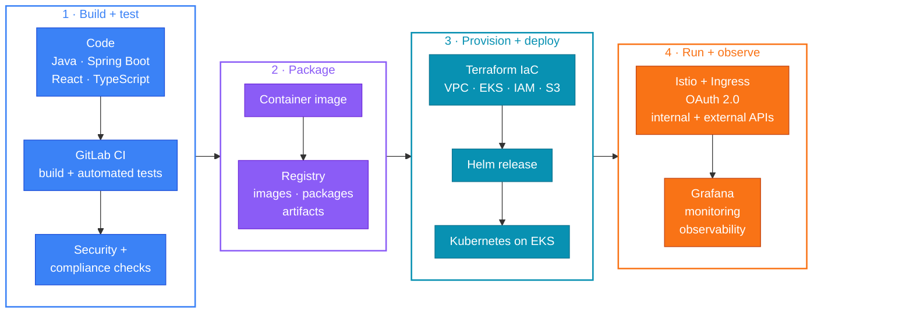

<!-- Header -->
<a href="https://orniepayer.com/">
<picture>
  <source media="(prefers-color-scheme: dark)" srcset="https://capsule-render.vercel.app/api?type=waving&height=230&section=header&color=0:0B1120%2C45:1E3A8A%2C100:6D28D9&text=Hallo%2C%20I'm%20Ornie&fontSize=58&fontAlignY=36&fontColor=ffffff&animation=fadeIn&desc=Software%20%C2%B7%20Platform%20%C2%B7%20Backend%20Engineer&descSize=20&descAlignY=58">
  
</picture>
</a>

<p align="center">
<picture>
  <source media="(prefers-color-scheme: dark)" srcset="https://readme-typing-svg.demolab.com?font=JetBrains+Mono&weight=600&size=22&duration=2800&pause=900&center=true&vCenter=true&width=540&height=46&lines=Software+Engineer;Platform+Engineer;Backend+Engineer;Kubernetes+%C2%B7+Cloud+Native+%C2%B7+DevSecOps;Secure%2C+scalable%2C+cloud-native+systems&color=7DD3FC">
  
</picture>
</p>

<p align="center">
<a href="https://orniepayer.com/"></a> <a href="https://portfolio-orniepays-projects.vercel.app/"></a> <a href="https://www.linkedin.com/in/ornie-payer/"></a> <a href="https://gitlab.com/Orniepay"></a> <a href="https://discord.com/users/1034588900267655300"></a>
</p>

<p align="center">

</p>

## About me

```yaml
# $ kubectl get engineer ornie -o yaml
apiVersion: people.dev/v1
kind: Engineer
metadata:
  name: ornie-payer
  labels:
    roles: software-engineer.platform-engineer.backend-engineer
spec:
  builds:
    - Kubernetes-based platform services
    - Cloud-native applications
    - Distributed systems, microservices, and APIs
    - Large-scale backend services
  languages: [Java, Python, TypeScript, JavaScript, C, Bash]
  platform:  [Kubernetes, Helm, Istio, Terraform, RHEL, Linux]
  clouds:    [AWS, GCP, Azure]
  delivery:  [GitLab CI, CI/CD, IaC, container registries]
  observe:   [Grafana, monitoring, automated tests]
status:
  phase: Running
  message: "Innovating the future, one line of code at a time."
```

## What I do

<table>
<tr>
<td width="50%" valign="top">
<h3> Platform engineering</h3>
<ul>
<li><b>Kubernetes-based platform services</b> and cloud-native apps</li>
<li><b>AWS</b> (EC2, EKS, IAM, S3, VPC), <b>GCP</b>, <b>Azure</b></li>
<li><b>Ingress</b>, <b>Istio service mesh</b>, proxies, and <b>OAuth 2.0</b> for internal and external API traffic</li>
</ul>
</td>
<td width="50%" valign="top">
<h3> Backend engineering</h3>
<ul>
<li>Design, build, test, and debug <b>large-scale backend services</b></li>
<li>Contribute to the design and evolution of <b>scalable distributed systems</b>, microservices, and APIs</li>
<li>Java, Spring Boot, Python, TypeScript, Gradle</li>
</ul>
</td>
</tr>
<tr>
<td width="50%" valign="top">
<h3> Secure software delivery</h3>
<ul>
<li>Build and improve <b>secure delivery</b> of container images, registries, packages, and deployment artifacts</li>
<li><b>CI/CD</b> with GitLab CI, continuous delivery, and automation</li>
<li><b>Infrastructure as Code</b>: Terraform, Helm, YAML</li>
</ul>
</td>
<td width="50%" valign="top">
<h3> Reliability and teamwork</h3>
<ul>
<li><b>Automated tests, monitoring, and observability</b> (Grafana) for long-term service health</li>
<li>Compliance best practices</li>
<li>Partner with product managers, stakeholders, clients, security engineers, infrastructure teams, and engineering peers on <b>customer-focused solutions</b></li>
</ul>
</td>
</tr>
</table>

## Tech stack

<sub>Hover an icon for its name. Click it for the official docs.</sub>

<table>
<tr>
<td align="right"><b>Languages</b></td>
<td>
<a href="https://dev.java/" title="Java"><picture><source media="(prefers-color-scheme: dark)" srcset="https://skillicons.dev/icons?i=java&theme=dark"></picture></a>
<a href="https://www.python.org/" title="Python"><picture><source media="(prefers-color-scheme: dark)" srcset="https://skillicons.dev/icons?i=python&theme=dark"></picture></a>
<a href="https://www.typescriptlang.org/" title="TypeScript"></a>
<a href="https://developer.mozilla.org/en-US/docs/Web/JavaScript" title="JavaScript"></a>
<a href="https://en.cppreference.com/w/c" title="C"></a>
<a href="https://www.gnu.org/software/bash/" title="Bash"><picture><source media="(prefers-color-scheme: dark)" srcset="https://skillicons.dev/icons?i=bash&theme=dark"></picture></a>
<a href="https://developer.mozilla.org/en-US/docs/Web/HTML" title="HTML"></a>
<a href="https://developer.mozilla.org/en-US/docs/Web/CSS" title="CSS"></a>
</td>
</tr>
<tr>
<td align="right"><b>Frontend</b></td>
<td>
<a href="https://react.dev/" title="React"><picture><source media="(prefers-color-scheme: dark)" srcset="https://skillicons.dev/icons?i=react&theme=dark"></picture></a>
<a href="https://redux.js.org/" title="Redux"></a>
<a href="https://vite.dev/" title="Vite"><picture><source media="(prefers-color-scheme: dark)" srcset="https://skillicons.dev/icons?i=vite&theme=dark"></picture></a>
<a href="https://nextjs.org/" title="Next.js"><picture><source media="(prefers-color-scheme: dark)" srcset="https://skillicons.dev/icons?i=nextjs&theme=dark"></picture></a>
<a href="https://tailwindcss.com/" title="Tailwind CSS"><picture><source media="(prefers-color-scheme: dark)" srcset="https://skillicons.dev/icons?i=tailwind&theme=dark"></picture></a>
<a href="https://jquery.com/" title="jQuery"></a>
</td>
</tr>
<tr>
<td align="right"><b>Backend</b></td>
<td>
<a href="https://spring.io/projects/spring-boot" title="Spring Boot"><picture><source media="(prefers-color-scheme: dark)" srcset="https://skillicons.dev/icons?i=spring&theme=dark"></picture></a>
<a href="https://nodejs.org/" title="Node.js"><picture><source media="(prefers-color-scheme: dark)" srcset="https://skillicons.dev/icons?i=nodejs&theme=dark"></picture></a>
<a href="https://expressjs.com/" title="Express"><picture><source media="(prefers-color-scheme: dark)" srcset="https://skillicons.dev/icons?i=express&theme=dark"></picture></a>
<a href="https://www.djangoproject.com/" title="Django"></a>
<a href="https://flask.palletsprojects.com/" title="Flask"><picture><source media="(prefers-color-scheme: dark)" srcset="https://skillicons.dev/icons?i=flask&theme=dark"></picture></a>
<a href="https://gradle.org/" title="Gradle"><picture><source media="(prefers-color-scheme: dark)" srcset="https://skillicons.dev/icons?i=gradle&theme=dark"></picture></a>
</td>
</tr>
<tr>
<td align="right"><b>Data</b></td>
<td>
<a href="https://www.postgresql.org/" title="PostgreSQL"><picture><source media="(prefers-color-scheme: dark)" srcset="https://skillicons.dev/icons?i=postgres&theme=dark"></picture></a>
<a href="https://www.mysql.com/" title="MySQL"><picture><source media="(prefers-color-scheme: dark)" srcset="https://skillicons.dev/icons?i=mysql&theme=dark"></picture></a>
<a href="https://www.mongodb.com/" title="MongoDB"></a>
</td>
</tr>
<tr>
<td align="right"><b>Cloud</b></td>
<td>
<a href="https://aws.amazon.com/" title="AWS"><picture><source media="(prefers-color-scheme: dark)" srcset="https://skillicons.dev/icons?i=aws&theme=dark"></picture></a>
<a href="https://cloud.google.com/" title="Google Cloud"><picture><source media="(prefers-color-scheme: dark)" srcset="https://skillicons.dev/icons?i=gcp&theme=dark"></picture></a>
<a href="https://azure.microsoft.com/" title="Azure"><picture><source media="(prefers-color-scheme: dark)" srcset="https://skillicons.dev/icons?i=azure&theme=dark"></picture></a>
</td>
</tr>
<tr>
<td align="right"><b>Platform</b></td>
<td>
<a href="https://kubernetes.io/" title="Kubernetes"></a>
<a href="https://www.docker.com/" title="Docker"></a>
<a href="https://developer.hashicorp.com/terraform" title="Terraform"><picture><source media="(prefers-color-scheme: dark)" srcset="https://skillicons.dev/icons?i=terraform&theme=dark"></picture></a>
<a href="https://docs.gitlab.com/ci/" title="GitLab CI/CD"><picture><source media="(prefers-color-scheme: dark)" srcset="https://skillicons.dev/icons?i=gitlab&theme=dark"></picture></a>
<a href="https://www.redhat.com/en/technologies/linux-platforms/enterprise-linux" title="Red Hat Enterprise Linux"><picture><source media="(prefers-color-scheme: dark)" srcset="https://skillicons.dev/icons?i=redhat&theme=dark"></picture></a>
<a href="https://www.kernel.org/" title="Linux"><picture><source media="(prefers-color-scheme: dark)" srcset="https://skillicons.dev/icons?i=linux&theme=dark"></picture></a>
<a href="https://grafana.com/" title="Grafana"><picture><source media="(prefers-color-scheme: dark)" srcset="https://skillicons.dev/icons?i=grafana&theme=dark"></picture></a>
</td>
</tr>
</table>

<details>
<summary><b>Cloud-native and DevSecOps toolkit</b> &nbsp;<sub>(click to expand)</sub></summary>
<br>

<table>
<tr>
<td align="right"><b>AWS</b></td>
<td>
<a href="https://aws.amazon.com/ec2/" title="Amazon EC2"></a>&nbsp;<b>EC2</b>&nbsp;&nbsp;
<a href="https://aws.amazon.com/eks/" title="Amazon EKS"></a>&nbsp;<b>EKS</b>&nbsp;&nbsp;
<a href="https://aws.amazon.com/iam/" title="AWS IAM"></a>&nbsp;<b>IAM</b>&nbsp;&nbsp;
<a href="https://aws.amazon.com/s3/" title="Amazon S3"></a>&nbsp;<b>S3</b>&nbsp;&nbsp;
<a href="https://aws.amazon.com/vpc/" title="Amazon VPC"></a>&nbsp;<b>VPC</b>&nbsp;&nbsp;
</td>
</tr>
<tr>
<td align="right"><b>Kubernetes platform</b></td>
<td>
    <code>Ingress</code> <code>Service&nbsp;mesh</code> <code>Containers</code>
</td>
</tr>
<tr>
<td align="right"><b>Traffic &amp; security</b></td>
<td>
 <code>Proxies</code> <code>Internal&nbsp;&amp;&nbsp;external&nbsp;API&nbsp;endpoints</code> <code>Secure&nbsp;software&nbsp;delivery</code>
</td>
</tr>
<tr>
<td align="right"><b>Delivery &amp; IaC</b></td>
<td>
    <code>CI/CD</code> <code>Continuous&nbsp;delivery</code> <code>Automation</code> <code>Infrastructure&nbsp;as&nbsp;Code</code>
</td>
</tr>
<tr>
<td align="right"><b>Artifacts</b></td>
<td>
<code>Container&nbsp;images</code> <code>Registries</code> <code>Packages</code> <code>Deployment&nbsp;artifacts</code>
</td>
</tr>
<tr>
<td align="right"><b>Ops &amp; reliability</b></td>
<td>
   <code>Monitoring</code> <code>Observability</code> <code>Automated&nbsp;tests</code> <code>Compliance</code>
</td>
</tr>
<tr>
<td align="right"><b>Systems</b></td>
<td>
<code>Distributed&nbsp;systems</code> <code>Microservices</code> <code>APIs</code> <code>Large-scale&nbsp;backend&nbsp;services</code>
</td>
</tr>
<tr>
<td align="right"><b>Data &amp; ML</b></td>
<td>
   
</td>
</tr>
</table>

</details>

## How I ship

<sub>Secure delivery flow, from commit to production. Use the controls on the diagram to zoom and pan.</sub>



## Featured projects

<table>
<tr>
<td width="33%" align="center" valign="middle">
<a href="https://ub-commons.vercel.app"></a>
</td>
<td width="33%" align="center" valign="middle">
<a href="https://vital-care-lyart.vercel.app"></a>
</td>
<td width="33%" align="center" valign="middle">
<a href="https://wayfarer-six.vercel.app"></a>
</td>
</tr>
<tr>
<td width="33%" align="center" valign="top">
<h3>UB Commons</h3>
<p>Food web app for UB Commons.</p>
<p>   </p>
</td>
<td width="33%" align="center" valign="top">
<h3>VitalCare</h3>
<p>Remote patient monitoring system web app.</p>
<p>   </p>
</td>
<td width="33%" align="center" valign="top">
<h3>WAYFARER</h3>
<p>Indie 2D platformer game.</p>
<p> </p>
</td>
</tr>
<tr>
<td width="33%" align="center" valign="middle">
<a href="https://ub-commons.vercel.app"></a>
<a href="https://github.com/Orniepay/UB-Commons"></a>
</td>
<td width="33%" align="center" valign="middle">
<a href="https://vital-care-lyart.vercel.app"></a>
<a href="https://github.com/Orniepay/VitalCare"></a>
</td>
<td width="33%" align="center" valign="middle">
<a href="https://wayfarer-six.vercel.app"></a>
<a href="https://github.com/Orniepay/WAYFARER"></a>
</td>
</tr>
</table>

<details>
<summary><b>More projects</b> &nbsp;<sub>(click to expand)</sub></summary>
<br>

| Project | What it is |
| --- | --- |
| [**Ghost Key**](https://github.com/Orniepay/ghost-key) | Morse-code communication app for people who can't speak or type. AI turns a few taps into full spoken sentences. Built with Kiro for Kiroween 2026. |
| [**Tasklify**](https://github.com/Orniepay/Tasklify) | Full-stack task manager: React, Node.js, Express, MySQL. Containerized with Docker and deployed on AWS. |
| [**YouTube AI Chatbot**](https://github.com/Orniepay/YouTube-AI-Chatbot) | AI chatbot with GPT-3.5-Turbo, MindsDB, and PostgreSQL. |
| [**Python Testing Templates**](https://github.com/Orniepay/Python-Testing-Templates) | Reusable animated terminal test runner: progress bars, pass and fail marks, PyCharm-style output in the VS Code terminal. |

</details>

## Support my work

<p align="left">
<a href="https://buymeacoffee.com/orniepayer"></a> <a href="https://buy.stripe.com/dR68wZ2GpesA9wY4gg"></a>
</p>

<picture>
  <source media="(prefers-color-scheme: dark)" srcset="https://capsule-render.vercel.app/api?type=waving&height=130&section=footer&text=Let's%20innovate%20together!&fontSize=26&fontAlignY=72&fontColor=ffffff&color=0:6D28D9%2C55:1E3A8A%2C100:0B1120">
  
</picture>
